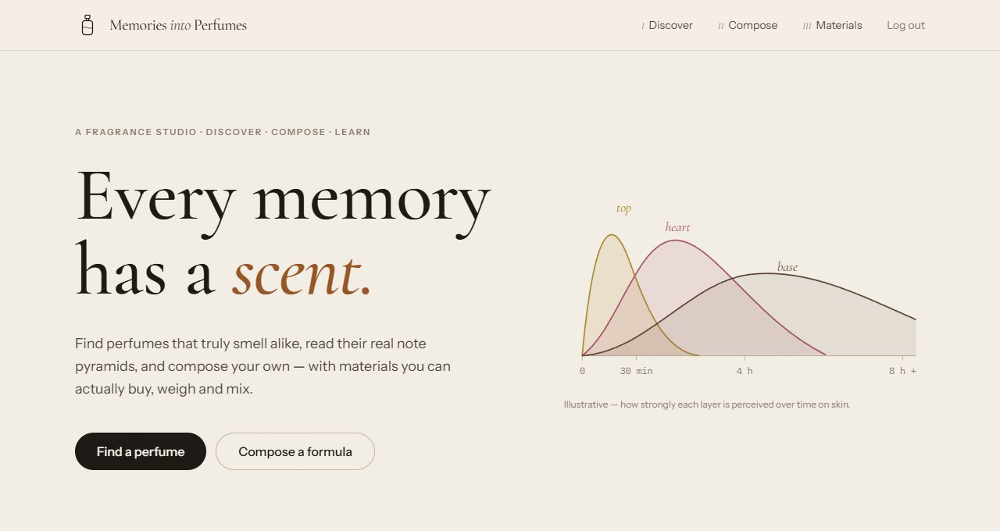
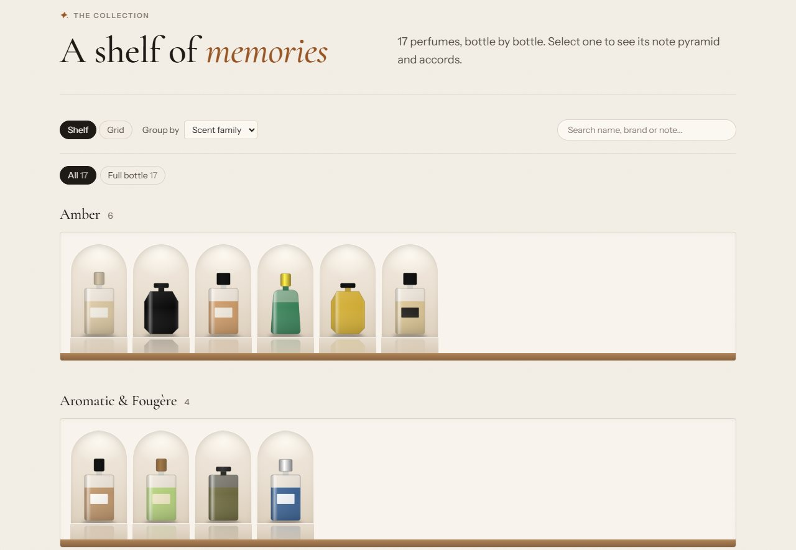
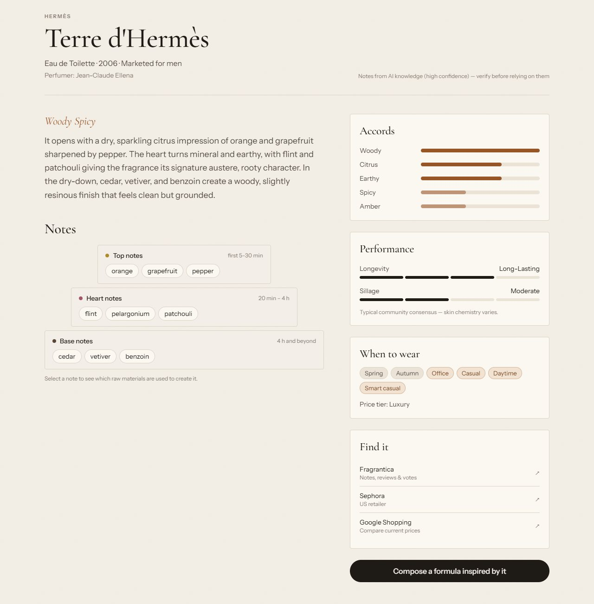
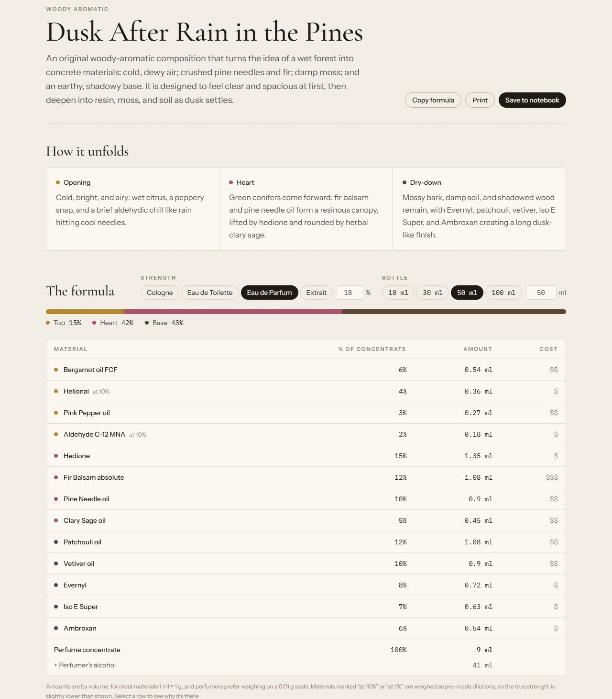
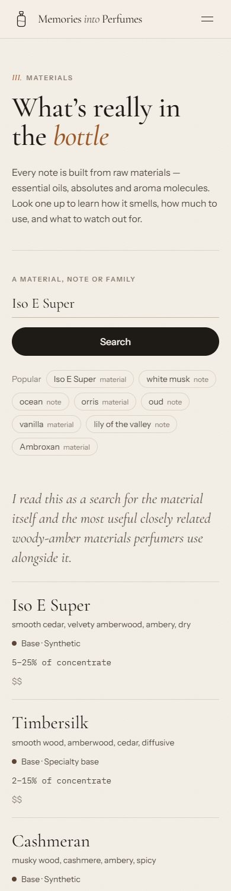
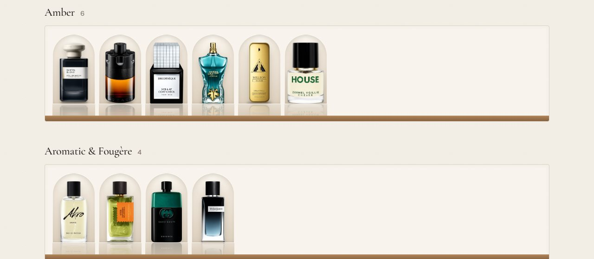

# Memories Into Perfumes

**An AI-powered fragrance studio: find perfumes that truly smell alike, look up accurate note pyramids, and turn a memory into a perfume formula you can actually mix.**

**See it live:** [my perfume collection](https://perfume-app-ruby.vercel.app/collection) — public, no login needed.
The full app at https://perfume-app-ruby.vercel.app is password-protected (access by invitation).

Built with Next.js 16, React 19, TypeScript, Tailwind CSS 4, Postgres and the OpenAI API.

---

## Why I built this

I collect perfume as a hobby — my collection is over 100 bottles — and I recently started making my own. That's when I hit a wall: good information on how to actually make perfume is surprisingly hard to find. Researching a formula meant piecing together forum threads, supplier pages and note lists, and working out which raw materials create which notes, how much of each to use, and which ones are restricted.

I wanted one place to do all of that, so I combined my two interests — coding and perfumery — and built it. Memories Into Perfumes is the tool I wished I'd had when I started: a way to explore the perfumes I love, understand what's in them, and turn an idea into a formula I can mix with the materials I have.

Building it brought its own challenge. General-purpose AI is confidently wrong about perfume: it invents shared notes between fragrances, treats marketing terms like "white musk" or "sea breeze" as ingredients you can buy, and suggests dosages that would ruin a formula. Much of the engineering here is about making AI **trustworthy in a specialist domain** — through prompt design, output validation, real data sources and an honest UI.

## What it does

| | |
|---|---|
| **Discover** | Find alternatives to a perfume — labelled as a near-identical dupe, close alternative, flanker or same family, with the notes they really share and how they differ. Look up any perfume's note pyramid, accords, performance and best seasons — including niche and indie releases, found via web search with links to the sources. |
| **Compose** | Describe a memory ("a rainy pine forest at dusk"), list the materials on your shelf, or name a perfume to reinterpret. Get a weighable formula of real, purchasable materials at realistic levels, with safety notes and a batch calculator for any strength and bottle size. |
| **Materials** | Learn what's behind a note — e.g. "white musk" → Galaxolide, Habanolide, Ethylene Brassylate — with typical usage, dilution, allergens and safety restrictions. |
| **Shelf** | My collection, bottle by bottle — add perfumes one at a time or paste a whole list. Each bottle stands in a lit display niche as an AI studio render made from the brand's real product photo. A [read-only public version](https://perfume-app-ruby.vercel.app/collection) shows the collection to visitors. |

---

## Engineering highlights

### Making AI trustworthy about perfume
- Every prompt carries a built-in perfumery reference — marketing notes vs. real materials, realistic usage levels, and safety rules — so formulas use ingredients you can buy at doses that work.
- The AI is allowed to say "I don't know" instead of guessing, and is never asked for things it can't know, like prices, stock or ratings.
- Every AI response is validated before it reaches the screen; formulas are always normalised to exactly 100%.

### Choosing the model with evidence
I ran the same prompts against four OpenAI models and checked the answers against published note lists. Older models invented similarities; the most accurate model took ~27 seconds per answer. **`gpt-5.4-mini` matched it closely in 4–18 seconds** and became the default.

### Real data first, AI second
Lookups check Fragrantica first, then the model's own knowledge, and only then run a live web search for niche and indie perfumes the AI has never seen — so well-known perfumes stay fast and cheap, and every web result links to its sources. A brand check rejects answers about the wrong perfume ("Red by Sora Dora" isn't *Red* by Giorgio Beverly Hills).

### A full-stack shelf with a privacy-safe public page
- Postgres database with versioned migrations and rules enforced in the database itself.
- The public collection reads from a query that only selects approved fields, so private notes, bottle sizes, wishlist items and photos can't leak — even by accident.
- Product photos are found on brand and retailer sites, cropped to the bottle, stored privately, and turned into consistent upright studio renders by an image model.

### Security
- Every page and API route sits behind a password login with signed sessions and rate limiting; I upgraded Next.js to close known login-bypass vulnerabilities and tested the fix by trying to break in.
- The server downloads images from addresses found on the web, so every download is checked against private and internal networks. Testing caught a real bypass in an early version, which I fixed.
- Uploaded photos are re-encoded to strip hidden data such as phone GPS location.

---

## Tech stack

- **Frontend:** Next.js 16, React 19, TypeScript, Tailwind CSS 4 — custom, responsive, accessible design system
- **Backend:** Next.js route handlers, Neon Postgres, Vercel Blob
- **AI:** OpenAI GPT-5.x (with web search) and image generation
- **Hosting:** Vercel
